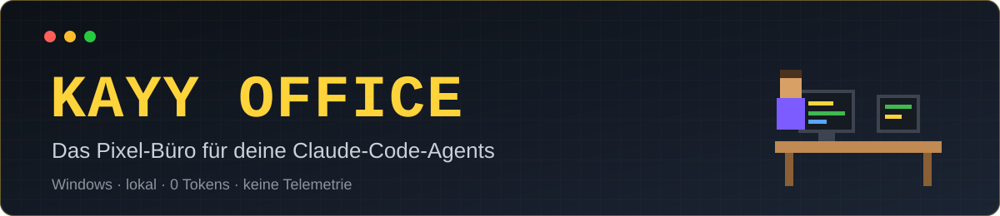
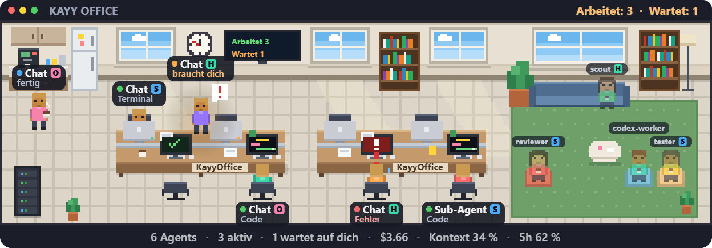
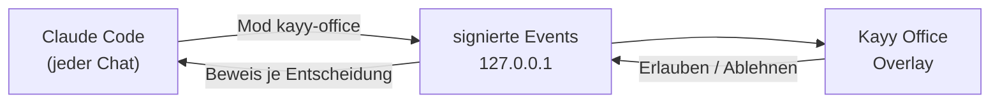
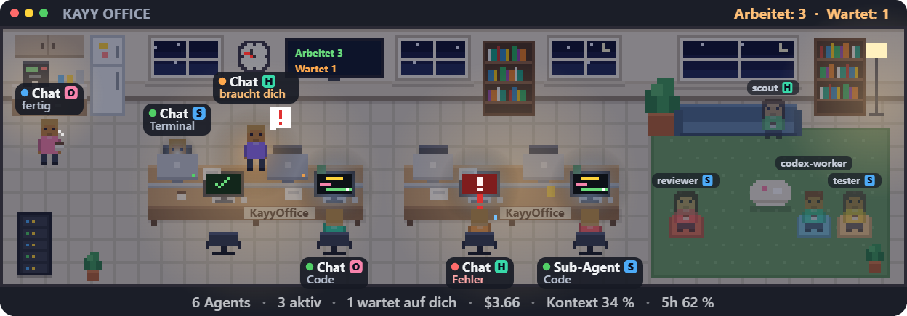
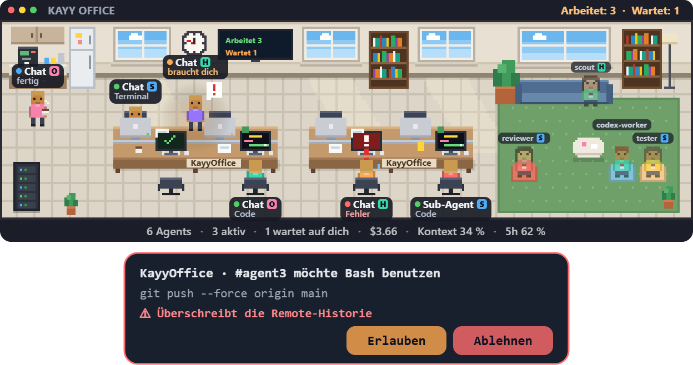
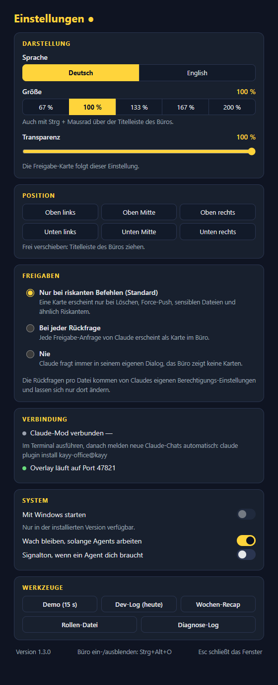

<div align="center">



<br>


**[🚀 Schnellstart](#-schnellstart) · [🔌 Claude-Mod](#-claude-mod-anschließen) · [🏢 Im Büro](#-im-büro) · [🚦 Freigaben](#-freigaben) · [🔒 Sicherheit](docs/SECURITY.md) · [🧱 Architektur](docs/ARCHITECTURE.md) · [📜 Changelog](CHANGELOG.md)**

<br>



</div>

<br>

Jeder Agent sitzt in einem gemeinsamen Büro: Wer arbeitet, **tippt am Schreibtisch**, wer dich braucht, **steht auf**, wer fertig ist, **holt sich Kaffee**. Freigaben, Fortschritt, Modell und Kosten siehst du auf einen Blick, auch wenn Claude im Hintergrund läuft.

| 🪙 Tokenfrei | 🔐 Lokal & signiert | 🤖 Subagents im Blick | 🛡️ Riskantes wird gebremst |
|:---:|:---:|:---:|:---:|
| kein LLM-Aufruf, kein Polling | nur `127.0.0.1`, HMAC-Anfragen | Typ, Modell, Datei, Fortschritt | Karte bei `rm -rf`, Force-Push … |

## 🚀 Schnellstart

**Am einfachsten: gib das Repo deinem Claude.** Voraussetzung: [Node.js 20+](https://nodejs.org) und Claude Code. Dann diesen Satz in eine Claude-Sitzung einfügen:

> Richte https://github.com/Kaajaa03/KayyOffice für mich ein: klone das Repo und führe darin `node scripts/setup.mjs` aus. Sag mir danach, was ich noch tun muss.

Oder selbst, auf **Windows, macOS und Linux** gleich:

```bash
git clone https://github.com/Kaajaa03/KayyOffice.git
cd KayyOffice
npm run setup      # installiert, baut, richtet den Claude-Mod ein und startet die App
```

Danach eine **neue** Claude-Sitzung öffnen und `/office` tippen. Entfernen: `claude plugin uninstall kayy-office@kayy`.

> **Plattformen:** Windows 10/11 ist der Hauptweg. Auf **macOS und Linux** läuft bei jedem Push in GitHub Actions automatisch: Typecheck, alle Tests, Build, Mod-Tests, das Setup-Skript und ein Start der App mit Demo-Screenshot. **Nicht automatisch geprüft** (braucht einen echten Desktop): transparentes Klick-durch-Fenster, Tray-Icon, Autostart und der Hotkey. Unter Linux braucht das transparente Fenster einen Compositor und das Tray-Icon unter GNOME die AppIndicator-Erweiterung. Ein fertiges Installer-Paket (`npm run dist`) gibt es nur für Windows.

Nur die App ohne Setup-Skript: `npm install && npm start`.

Beim ersten Start öffnen sich die **Einstellungen** mit kurzer Einführung (Sprache, Installationsbefehl für den Mod, **Demo** 15 s). Das Büro erscheint oben mittig, sobald Agents arbeiten.

| Taste / Aktion | Wirkung |
|---|---|
| **Strg + Alt + O** | Büro ein- und ausblenden |
| Doppelklick aufs Tray-Icon | Einstellungen |
| Titelleiste ziehen | Büro verschieben (Position wird gemerkt) |
| **Strg + Mausrad** auf der Titelleiste | Größe: 67 / 100 / 133 / 167 / 200 % |

Installer: `npm run dist` erzeugt `release/Kayy Office Setup <Version>.exe` und eine Portable-Version. Die installierte App startet ab dem ersten Start mit Windows (abschaltbar).

## 🔌 Claude-Mod anschließen

Der Mod `kayy-office` ist der **einzige Weg**: Status, Modell pro Agent, Kosten, Datei, Fortschritt der Aufgabenliste, Router, Freigaben, Pane in der Claude-App, Autopilot und Orchestrierungs-Richtlinie. Er gilt für jeden Chat ohne weitere Einrichtung.



`npm run setup` erledigt das schon. Von Hand:

```bash
claude plugin marketplace add <Pfad-zum-Repo>
claude plugin install kayy-office@kayy
```

Danach in einer neuen Sitzung `/office` (Pane und Status). Entfernen: `claude plugin uninstall kayy-office@kayy`. Ohne laufende App tut der Mod still nichts. Details: [mod/kayy-office/README.md](mod/kayy-office/README.md).

## 🏢 Im Büro

<div align="center">

<br><sub>Nachts leuchten Lampen und Bildschirme. Tageszeit und Sonnenstand folgen der echten Zeit.</sub>
</div>

<br>

| Zustand | Was du siehst |
|---|---|
| ⌨️ **arbeitet** | Bildschirm zeigt Code, Terminal oder Browser |
| ❗ **braucht dich** | Figur steht auf, „!“ über dem Kopf |
| 💬 **Entscheidung** | Claude hat dir eine echte Frage gestellt |
| ☕ **fertig** | Kaffee, danach Lounge |
| 🟥 **Fehler** | roter Bildschirm |
| 💤 **ruht** | Chat unbenutzt, nach 5 Minuten verschwindet die Figur |

- **Namensschild:** Status-Punkt, Name, Modell-Chip (**H**aiku, **S**onnet, **O**pus, **F**able), darunter Aufgabe oder Datei und ein goldener **Fortschrittsbalken** der Aufgabenliste.
- **Wartebereich:** Die Agent-Typen, die der Mod meldet (Scout, Coder, Tester …), sitzen gedimmt in der Lounge und gehen an einen Schreibtisch, sobald sie arbeiten. Der Wartebereich überlebt einen Neustart.
- **Fußzeile:** Anzahl, aktiv, wartend, Session-Kosten, **Kontext** (ab 70 % bernstein, ab 85 % rot) und Konto-Limit (`5h 21 %`).
- **Größe und Transparenz:** fünf Stufen mit ganzen Bildschirmpixeln (scharfe Kanten), Transparenz 50 bis 100 % auch für die Freigabe-Karte. Zu große Stufen werden auf kleinen Bildschirmen begrenzt.
- **Sprache:** Deutsch oder Englisch, Standard nach System. **Reduzierte Bewegung** (Windows) wird respektiert.

## 🚦 Freigaben

<div align="center">

</div>

<br>

| Modus | Verhalten |
|---|---|
| **Nur bei riskanten Befehlen** (Standard) | Karte bei `rm -rf`, `Remove-Item -Recurse`, `git reset --hard`, `git push --force`, `git clean -f`, `curl … \| bash`, `DROP TABLE`, `format X:` und sensiblen Dateien. Rote Warnzeile mit Ziel, **Erlauben** erst nach 1,5 s klickbar |
| Bei jeder Rückfrage | jede Anfrage |
| Nie | immer Claudes normaler Dialog |

Keine Antwort in 20 s, App aus oder Fehler ⇒ ganz normaler Claude-Dialog, **nie** ein stilles „Erlauben“. `ExitPlanMode` beantwortet das Overlay nie; `AskUserQuestion` nur als Fragekarte mit einem Knopf je Option. Die Rückfragen **pro Datei** kommen von Claudes eigenem Berechtigungssystem und lassen sich nur dort ändern.

## 🤖 Orchestrator (im Mod)

| Befehl | Wirkung |
|---|---|
| `/office` | Pane und Status in der Claude-App |
| `/office autopilot on\|off` | Standard **aus**. Gibt nur Routine frei: Lesen/Schreiben im Projektordner und eine enge Shell-Liste. Nie ein „Nein“ von Claude, nie Pläne, Fragen, MCP oder Web. `git commit` wartet immer auf dich |
| `/office orchestrator on\|off` | Standard **an**. Kurzer System-Prompt-Abschnitt (rund 125 Tokens, im Cache): Claude delegiert **von selbst nach festen Auslösern** |
| `/router on\|off` | wählt für Subagents das passende Modell |

**Delegations-Auslöser:** mehr als 2 Dateien suchen oder lesen → `kayy-scout` (Haiku) · Umsetzung nach Plan → `kayy-coder` (Sonnet) · fehlende Tests → `kayy-tester` · vor dem Abschluss größerer Diffs → `kayy-reviewer` · Design und schwere Bugs → `kayy-architect` (Opus). Einzeiler bleiben direkt. Gefragt wirst du nur bei Unumkehrbarem, Richtung oder Kosten.

Die Subagent-Typen liegen als Dateien in `~/.claude/agents/`.

## ⚙️ Einstellungen

<table>
<tr>
<td width="38%" valign="top">



</td>
<td valign="top">

Tray-Menü: Anzeigen/Verstecken, **Einstellungen…**, Demo zeigen, Beenden. Alles andere liegt im Fenster, Änderungen wirken sofort, nichts braucht einen Neustart.

| Bereich | Inhalt |
|---|---|
| **Darstellung** | Sprache, Größe, Transparenz |
| **Position** | sechs Plätze im Raster |
| **Freigaben** | riskant / alle / nie |
| **Verbindung** | Mod verbunden ✓/—, Installationsbefehl, Port |
| **System** | Mit Windows starten, Wach bleiben, Signalton wenn ein Agent dich braucht (Standard aus) |
| **Werkzeuge** | Demo, Dev-Log, Wochen-Recap, Rollen-Datei, Diagnose-Log |

Gespeichert in `%APPDATA%\KayyOffice\config.json`.

</td>
</tr>
</table>

## 📋 Rollen, Dev-Log, Ressourcen

<details>
<summary><b>Rollen und Projekte</b> (<code>roles.json</code>)</summary>

<br>

`%APPDATA%\KayyOffice\roles.json` wird beim ersten Start mit Beispielen angelegt (Einstellungen → Werkzeuge → „Rollen-Datei“). Änderungen gelten sofort nach dem Speichern.

```json
[{ "match": { "namePattern": "review" }, "role": "Reviewer", "color": "#ffa94d" }]
```

`namePattern` (Regex) trifft auf Agent-ID und Subagent-Typ, `cwdContains` auf den Arbeitsordner; der erste Treffer gewinnt, Farben nur als `#rrggbb`. Agents desselben Projekts sitzen zusammen.

</details>

<details>
<summary><b>Dev-Log</b> (Tageszusammenfassung als Markdown)</summary>

<br>

Events werden pro Tag als JSONL unter `%APPDATA%\KayyOffice\logs` gesammelt, ohne Nachrichten- und Aufgabentexte; Dateien älter als 30 Tage löscht der Start. „Dev-Log (heute)“ und „Wochen-Recap“ erzeugen Markdown mit Tool-Calls, aktiver Zeit, erledigten Aufgaben und Dateien. Zielordner per `devLogDir` in `config.json` (z. B. Obsidian-Vault); Dateinamen `kayy-devlog-<Datum>.md`, damit nie eine eigene Notiz überschrieben wird.

</details>

<details>
<summary><b>Was spart Tokens, was nicht (ehrlich)</b></summary>

<br>

| | Wirkung |
|---|---|
| Büro, Overlay, Tray, Dev-Log | **0 Tokens**, rein lokal |
| **Router** (Subagents auf Haiku/Sonnet statt Opus) | **spart** merklich, sobald Subagents laufen |
| **Kontext- und Limit-Anzeige** | verhindert teure Überlänge: ab 70 % ist Zeit für `/compact` oder eine neue Sitzung |
| Orchestrierungs-Richtlinie | kostet ~125 Tokens je Turn (aus dem Cache); spart nur, wenn **große Suchausgaben aus dem Haupt-Kontext bleiben**. Abschalten: `/office orchestrator off` |
| Subagents allgemein | **kosten selbst**: jeder startet kalt und liest Dateien neu |
| Autopilot, Freigabe-Karten | sparen **deine Zeit**, keine Tokens |

</details>

<details>
<summary><b>Ressourcen</b> (<code>npm run perf</code>)</summary>

<br>

| | CPU | RAM (privat, alle Prozesse) |
|---|---|---|
| Leerlauf | ~0,01–0,1 % | ~80 MB |
| 5 Agents aktiv | ~1 % | ~100 MB |

Event-getriebenes Rendering (ohne Aktivität keine Animationsschleife, kein Dauer-Timer), einmal gezeichneter Raum im Cache, GPU-Rendering als Standard (nötig, damit das transparente Fenster sichtbar ist). `KAYY_GFX=sw` schaltet auf den Software-Modus (RAM ~halb, Overlay kann auf manchen Systemen unsichtbar bleiben).

</details>

## 🔒 Sicherheit

- Anfragen an die App sind **signiert** (HMAC über Nonce, Pfad und Body), der Token geht nie über den Draht; Antworten tragen einen Beweis für genau diese Entscheidung.
- Server nur auf `127.0.0.1`, Host-Prüfung gegen DNS-Rebinding, Body-Limit, strikte Validierung.
- Electron mit Sandbox, Context-Isolation, ohne Node-Zugriff, strenge CSP; kein Aufruf nach außen, keine Telemetrie.
- Der Autopilot arbeitet mit Positivliste und wurde adversarial geprüft.

Alles im Detail: [docs/SECURITY.md](docs/SECURITY.md) · Aufbau und Protokoll: [docs/ARCHITECTURE.md](docs/ARCHITECTURE.md). Fehler der App landen als einzeilige Meldungen (ohne Tokens, Befehle, Tool-Ausgaben) in `%APPDATA%\KayyOffice\app.log`.

> **Hinweis:** Die Installer sind nicht signiert, SmartScreen warnt deshalb. Auf verwalteten Rechnern vorher die IT fragen oder aus dem Quellcode starten (`npm start`).

## 🧑‍💻 Entwicklung

```bash
npm run check        # Typecheck (strikt) + alle Tests
npm run mock -- team # Fake-Events (single | team | permission | error | cleanup)
npm run perf         # Leerlauf-Abnahme (PASS/FAIL); "-- active" für Last
npm run dist         # Installer + Portable nach release/
claude plugin test mod/kayy-office   # Mod-Tests
```

<details>
<summary><b>Debug-Flags</b></summary>

<br>

`--demo`, `--demo-count=<n>`, `--screenshot=<png>`, `--hour=<0-23>`, `--no-card`, `--settings`, `--scale=<0.67|1|1.33|1.67|2>`, `--lang=<de|en>`, `--config-dir=<Ordner>` (eigene Konfiguration für Testläufe), `--claude-dir=<Ordner>` (ersetzt `~/.claude`). Scale und Sprache per Flag werden nicht gespeichert. CI: GitHub Actions (`.github/workflows/ci.yml`).

</details>

## 🗺️ Roadmap

Weitere Tools (Codex, Cursor) als Adapter, Tauri-Portierung für noch weniger RAM. Bewusst nicht geplant: Chat-zu-Chat-Nachrichten (Endlos-Ping-Pong-Risiko), Telemetrie, Auto-Update.
