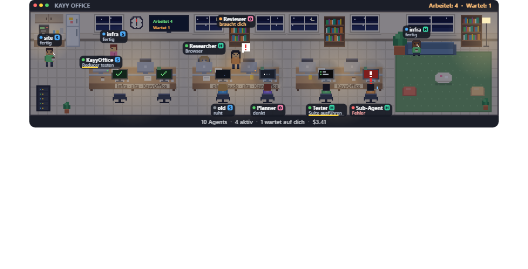

# Kayy Office

Pixel-Büro für **Claude-Code-Agents** unter Windows. Jeder Agent sitzt in einem gemeinsamen Büro: Wer arbeitet, tippt am Schreibtisch, wer dich braucht, steht auf, wer fertig ist, holt sich Kaffee. Freigaben, Fortschritt, Modell und Kosten siehst du auf einen Blick, auch wenn Claude im Hintergrund läuft.

**Lokal und tokenfrei:** kein LLM-Aufruf, kein Polling, keine Telemetrie, kein Hosting. Alles läuft über `127.0.0.1`.



## Schnellstart
```bash
npm install
npm start          # baut und startet die App (Tray-Icon unten rechts)
```
Beim ersten Start öffnet sich ein **Willkommensfenster** (Sprache wählbar) mit Status, „Hooks installieren“, einer **Demo** (15 s) und dem Knopf „Einstellungen öffnen“. Das Büro erscheint oben mittig, sobald Agents arbeiten. **Strg+Alt+O** blendet es ein und aus; Doppelklick auf das Tray-Icon öffnet die **Einstellungen**. Voraussetzung: Node.js im PATH (für Hooks). Installer: `npm run dist` erzeugt `release/Kayy Office Setup <Version>.exe` und eine Portable-Version.

## Zwei Wege, Agents anzuschließen
| Weg | Was du bekommst |
|---|---|
| **Claude-Mod `kayy-office`** (empfohlen) | Status, Modell pro Agent, Kosten, Datei, **Fortschritt der Aufgabenliste**, Router, Freigaben, Pane in der Claude-App, Autopilot und Orchestrierungs-Richtlinie |
| **Hooks** (Einstellungen → Verbindung → „Installieren“) | Status, Datei, Fortschritt, Freigaben; funktioniert auch mit der CLI ohne Mod |

Beides gleichzeitig ist erlaubt: Meldet der Mod für eine Session, ignoriert das Overlay die Hook-Events derselben Session (keine Doppelzählung, keine Doppelkarten).

**Mod installieren (lokal):**
```bash
claude plugin marketplace add C:\Users\<du>\IdeaProjects\KayyOffice
claude plugin install kayy-office@kayy
```
Danach in einer neuen Sitzung `/office` (Pane und Status). Entfernen: `claude plugin uninstall kayy-office@kayy`. Den alten Mod `kayy-router` nicht parallel laden, der neue enthält den Router. Ohne laufende App tut der Mod still nichts. Details: [mod/kayy-office/README.md](mod/kayy-office/README.md).

## Im Büro
- **Namensschild:** Status-Punkt, Name, Modell-Chip (**H**aiku, **S**onnet, **O**pus, **F**able), darunter die aktuelle Aufgabe oder Datei. Ein goldener Balken zeigt den **Fortschritt** der Aufgabenliste (`TodoWrite`).
- **Zustände:** *arbeitet* (Bildschirm zeigt Code, Terminal oder Browser), *braucht dich* (steht auf, „!“), *Entscheidung* (Claude hat dir eine echte Frage gestellt), *fertig* (Kaffee, dann Lounge), *Fehler* (roter Bildschirm, ausgelöst durch `PostToolUseFailure`), *ruht*.
- **Licht:** Tageszeit und Sonnenstand folgen der echten Zeit, nachts leuchten Lampen und Bildschirme. Fußzeile: Anzahl, aktiv, wartend, Session-Kosten, **Kontext** der Session (z. B. „Kontext 34 %“) und Konto-Limit („5h 21 %“); ab 70 % bernstein, ab 85 % rot.
- **Wartebereich:** Die Agent-Typen, die der Claude-Mod meldet (Scout, Coder, Tester …), sitzen gedimmt auf Sofa und Sitzsäcken der Lounge, mit Kürzel und Modell-Chip. Sobald ein Typ arbeitet, wechselt er an einen Schreibtisch; mehr als sechs Wartende erscheinen als „+n“.
- **Sprache:** Deutsch oder Englisch (Einstellungen → Darstellung), Standard nach System. **Reduzierte Bewegung** (Windows-Einstellung) wird respektiert.
- **Verschieben:** Die Titelleiste des Büros („KAYY OFFICE“) mit der Maus ziehen, die Position wird gemerkt und bleibt auch nach einem Monitor-Wechsel erreichbar. Feste Plätze (oben/unten, links/Mitte/rechts) unter Einstellungen → Position.
- **Größe und Transparenz:** fünf Stufen (67, 100, 133, 167, 200 %), jede ergibt ganze Bildschirmpixel pro Pixel-Kunst-Einheit, also scharfe Kanten. Auch mit **Strg + Mausrad** über der Titelleiste. Auf kleinen Bildschirmen wird die Stufe automatisch auf das begrenzt, was passt. Die Transparenz (50 bis 100 %) gilt für das ganze Fenster, **auch für die Freigabe-Karte**.

## Freigaben
Das Overlay zeigt eine Karte mit **Erlauben / Ablehnen**, wenn Claude etwas freigeben lassen will (Einstellungen → Freigaben):

| Modus | Verhalten |
|---|---|
| **Nur bei riskanten Befehlen** (Standard) | Karte nur bei `rm -rf`, `Remove-Item -Recurse`, `git reset --hard`, `git push --force`, `git clean -f`, `curl … \| bash`, `DROP TABLE`, `format X:` und sensiblen Dateien. Rote Warnzeile mit Ziel, Erlauben erst nach 1,5 s klickbar |
| Bei jeder Rückfrage | jede Anfrage |
| Nie | immer Claudes normaler Dialog |

Keine Antwort in 20 s, App aus oder Fehler ⇒ ganz normaler Claude-Dialog. `ExitPlanMode` und `AskUserQuestion` beantwortet das Overlay nie. Die Karte nennt Rolle/Projekt, Agent-Typ und bei Verwechslungsgefahr ein Session-Kürzel. Die Rückfragen **pro Datei** kommen von Claudes eigenem Berechtigungssystem und lassen sich nur dort ändern (Auto-accept edits oder eine `Edit(...)`-Regel in deinen Einstellungen).

## Orchestrator (im Mod)
- **Autopilot** `/office autopilot on|off|status` (Standard **aus**): gibt nur Routine ohne Rückfrage frei, nämlich Lesen und Schreiben im Projektordner sowie eine enge Liste von Shell-Befehlen. Nie ein „Nein“ von Claude, nie Pläne, Fragen, MCP oder Web. Nur für eigene, vertrauenswürdige Projekte.
- **Orchestrierungs-Richtlinie** `/office orchestrator on|off` (Standard **an**): ein kurzer System-Prompt-Abschnitt (rund 125 Tokens, im Cache). Er sagt Claude, **direkt zu arbeiten und nur dann zu delegieren, wenn es sich lohnt**, weil ein Subagent kalt startet: breite Suchen → `kayy-scout` (Haiku), unabhängige Aufgaben parallel, klare Umsetzung → `kayy-coder` (Sonnet), fehlende Tests → `kayy-tester`, riskante oder große Diffs vor dem Abschluss → `kayy-reviewer`, Design und schwere Bugs → `kayy-architect` (Opus). Dich fragt Claude nur bei Unumkehrbarem, Richtung oder Kosten.
- **Subagent-Typen** liegen als Dateien in `~/.claude/agents/` (`kayy-scout`, `kayy-coder`, `kayy-tester`, `kayy-reviewer`, `kayy-architect`); sie stehen im Wartebereich des Büros, bis sie gebraucht werden.
- **Entscheidungs-Signal:** stellt Claude eine echte Frage, steht der Agent auf und zeigt „Entscheidung“.
- **Router** `/router status|on|off`: wählt für Subagents das passende Modell.

## Rollen und Projekte
`%APPDATA%\KayyOffice\roles.json` (beim ersten Start mit Beispielen angelegt, Einstellungen → Werkzeuge → „Rollen-Datei“; Änderungen gelten sofort nach dem Speichern):
```json
[{ "match": { "namePattern": "review" }, "role": "Reviewer", "color": "#ffa94d" }]
```
`namePattern` (Regex) trifft auf Agent-ID und Subagent-Typ, `cwdContains` auf den Arbeitsordner; der erste Treffer gewinnt, Farben nur als `#rrggbb`. Agents desselben Projekts sitzen zusammen.

## Dev-Log
Events werden pro Tag als JSONL unter `%APPDATA%\KayyOffice\logs` gesammelt (ohne Nachrichtentext, ohne Aufgabentexte; Dateien älter als 30 Tage werden beim Start gelöscht). Einstellungen → Werkzeuge → „Dev-Log (heute)“ und „Wochen-Recap“ erzeugen Markdown mit Tool-Calls, aktiver Zeit, erledigten Aufgaben und Dateien. Zielordner per `devLogDir` in `config.json` (z. B. Obsidian-Vault); Dateinamen `kayy-devlog-<Datum>.md`, damit nie eine eigene Notiz überschrieben wird.

## Einstellungen
Tray-Menü: Anzeigen/Verstecken, **Einstellungen…**, Demo zeigen, Beenden. Alles andere liegt im Einstellungsfenster (Tastatur-bedienbar, Esc schließt, nichts braucht einen Neustart, Änderungen wirken sofort):


| Bereich | Inhalt |
|---|---|
| **Darstellung** | Sprache, Größe (5 Stufen mit Anzeige, z. B. „133 %“), Transparenz-Regler |
| **Position** | sechs Plätze als Raster; sonst Titelleiste ziehen |
| **Freigaben** | riskant / alle / nie, mit je einem Satz Erklärung |
| **Verbindung** | Hooks installiert ✓/✗ mit Installieren/Entfernen (Ergebnis direkt im Fenster), Claude-Mod verbunden (in den letzten 5 Minuten aktiv), Port |
| **System** | Mit Windows starten (nur installierte Version), Wach bleiben |
| **Werkzeuge** | Demo, Willkommen/Hilfe, Dev-Log, Wochen-Recap, Rollen-Datei, Diagnose-Log |

Gespeichert in `config.json` (`scale`, `position`/`placement`, `opacity`, `language`, `approvals`, `awake`).

## Was spart Tokens, was nicht (ehrlich)
| | Wirkung |
|---|---|
| Büro, Overlay, Tray, Dev-Log | **0 Tokens**, rein lokal |
| **Router** (Subagents auf Haiku/Sonnet statt immer Opus) | **spart** merklich, sobald Subagents laufen |
| **Kontext- und Limit-Anzeige** | verhindert teure Überlänge: Kontext ab 70 % ist Zeit für `/compact` oder eine neue Sitzung, denn jeder Turn liest den ganzen Kontext neu |
| Orchestrierungs-Richtlinie | kostet ~125 Tokens je Turn (aus dem Cache, ein Bruchteil davon als Preis); spart nur, wenn dadurch **große Suchausgaben aus dem Haupt-Kontext bleiben**. Wer sie nicht will: `/office orchestrator off` |
| Subagents allgemein | **kosten selbst**: jeder startet kalt und liest Dateien neu. Lohnen sich bei breiten Suchen und Parallelarbeit, nicht für Kleinkram |
| Autopilot, Freigabe-Karten | sparen **deine Zeit**, keine Tokens |
| Hooks | kosten ~60 ms je Aufruf, laufen jetzt asynchron; mit dem Mod überflüssig (das Overlay bietet an, sie zu entfernen) |

## Ressourcen (`npm run perf`)
| | CPU | RAM (privat, alle Prozesse) |
|---|---|---|
| Leerlauf | ~0,01–0,1 % | ~80 MB |
| 5 Agents aktiv | ~1 % | ~100 MB |

Möglich durch event-getriebenes Rendering (ohne Aktivität keine Animationsschleife, kein Dauer-Timer), einmal gezeichneten Raum im Cache und Software-Rendering mit In-Process-GPU. `KAYY_GFX=hw` schaltet auf GPU-Rendering.

## Sicherheit und Diagnose
Anfragen an die App sind signiert, der Token geht nie über den Draht; Details in [docs/SECURITY.md](docs/SECURITY.md). Aufbau und Protokoll: [docs/ARCHITECTURE.md](docs/ARCHITECTURE.md). Fehler der App landen als einzeilige Meldungen (ohne Tokens, Befehle, Tool-Ausgaben) in `%APPDATA%\KayyOffice\app.log` (Einstellungen → Werkzeuge → „Diagnose-Log“, max. 256 KB plus `app.log.1`).

## Entwicklung
```bash
npm run check        # Typecheck (strikt, inkl. ungenutzter Variablen) + alle Tests
npm run mock -- team # Fake-Events (single | team | permission | error | cleanup)
npm run perf         # Leerlauf-Abnahme (PASS/FAIL); "-- active" für Last
npm run dist         # Installer + Portable nach release/
```
Debug-Flags: `--demo`, `--demo-count=<n>`, `--screenshot=<png>`, `--hour=<0-23>`, `--no-card`, `--welcome`, `--no-welcome`, `--settings`, `--scale=<0.67|1|1.33|1.67|2>`, `--lang=<de|en>`, `--config-dir=<Ordner>` (eigene Konfiguration für Testläufe). Scale und Sprache per Flag werden nicht gespeichert. Mod-Tests: `claude plugin test mod/kayy-office`. CI: GitHub Actions (`.github/workflows/ci.yml`).

## Roadmap
Weitere Tools (Codex, Cursor) als Adapter, Tauri-Portierung für noch weniger RAM. Bewusst nicht geplant: Chat-zu-Chat-Nachrichten (Endlos-Ping-Pong-Risiko), Telemetrie, Auto-Update.
